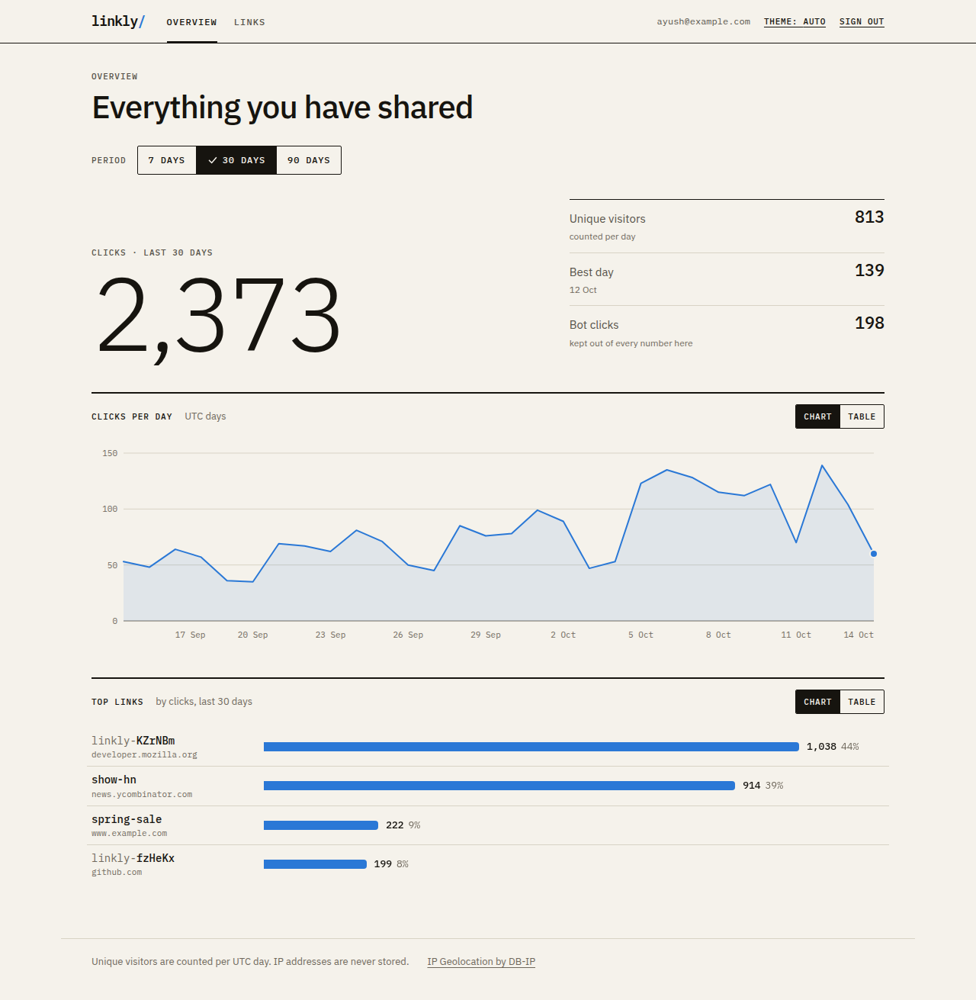
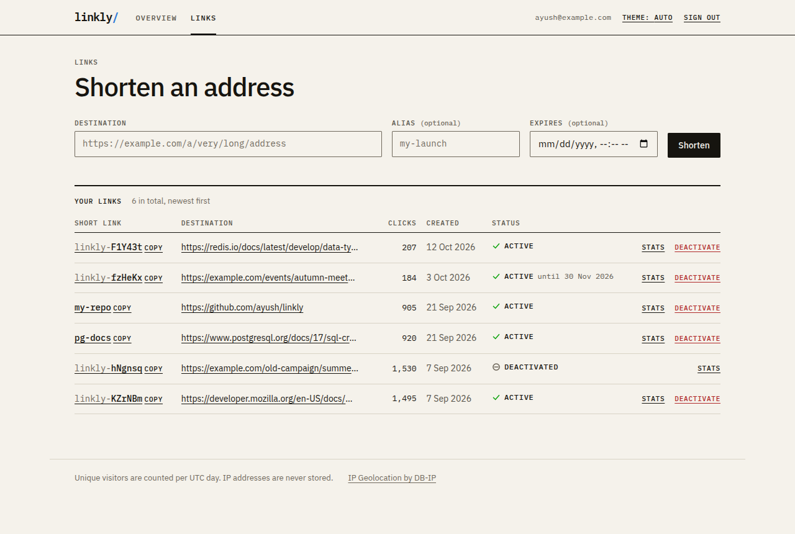
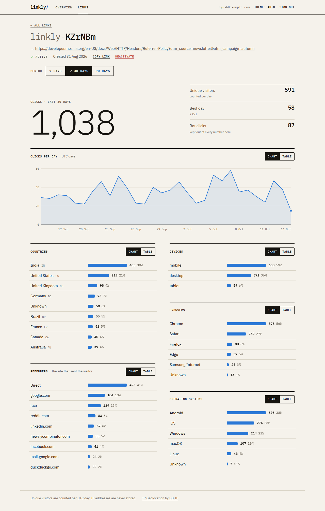
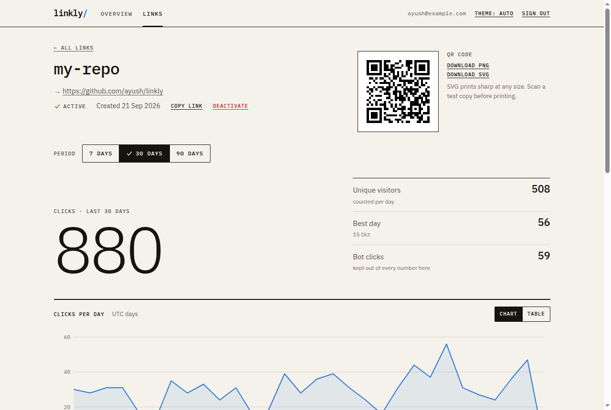
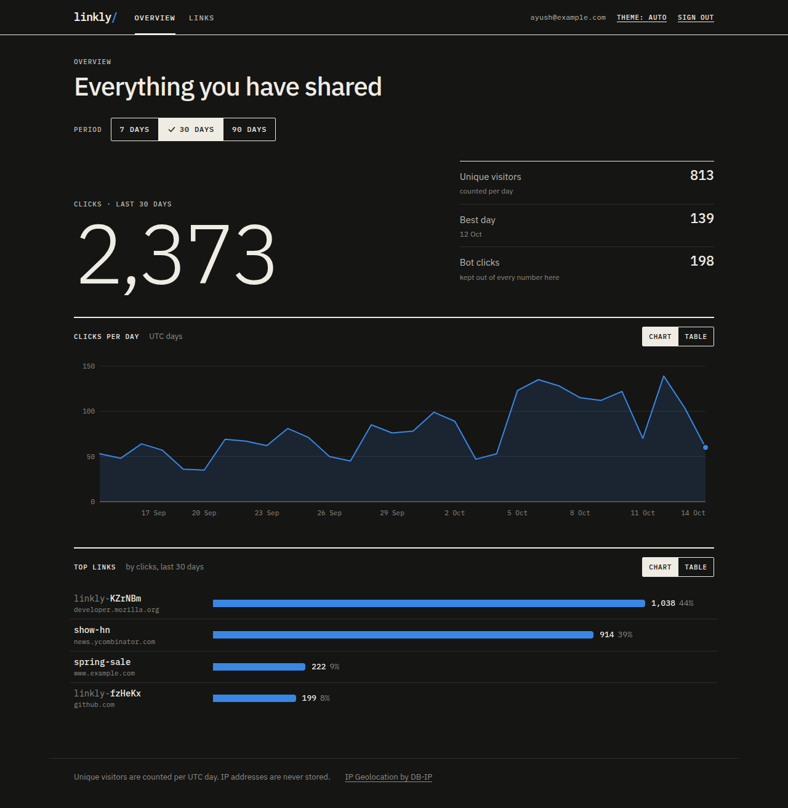
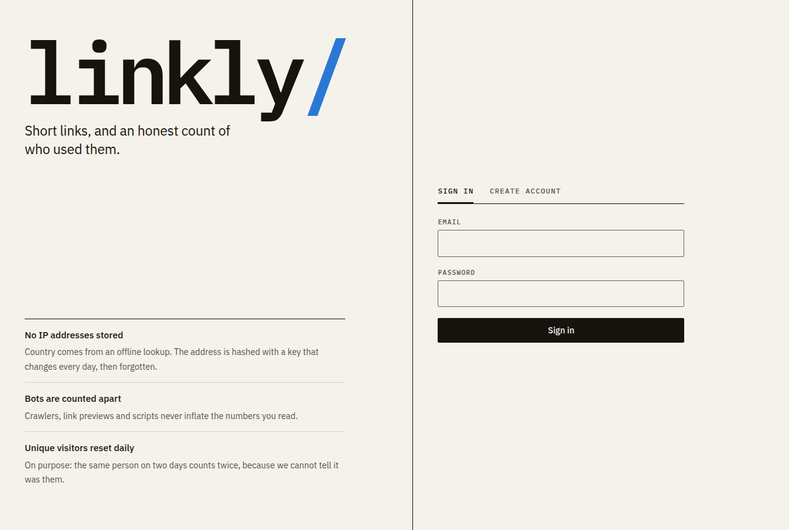
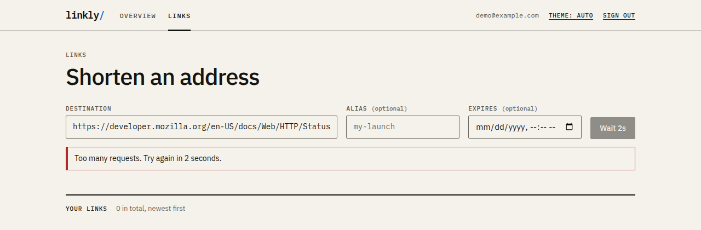

# Linkly

A URL shortener with a click-analytics dashboard. Spring Boot 4 (Java 21), PostgreSQL, Redis and a React + TypeScript frontend, built to behave correctly under load and when things fail.

**Live demo:** https://linkly-qx23.onrender.com



*Screenshots use generated demo data.*

## What it does

- Shorten any http(s) URL up to 8,192 characters, with an optional custom alias and expiry. Generated codes look like `linkly-KZrNBm`.
- A QR code for every link (PNG and SVG), drawn on the server.
- A dashboard per link and overall: clicks per day, unique visitors, countries, devices, browsers, OS and referrers. Bots and link-preview fetchers are counted separately so they never inflate the numbers.
- Accounts with email and password, or Google sign-in.
- Privacy by design: IP addresses are never stored, and unique visitors are counted per day on purpose.

## Features

**Shorten and manage links.** Paste an address, optionally pick an alias and an expiry. Each link shows its clicks, status and expiry, and can be copied, inspected or deactivated.



**A dashboard for every link.** Total clicks, unique visitors, the best day, a clicks-per-day chart, and breakdowns by country, device, browser, operating system and referrer. Every chart has a table view, and bots are counted separately.



**QR code for every link.** Download it as PNG or SVG.



**Light and dark.** Both are designed, with a manual toggle.



**Sign in with email or Google.** The page says up front what is and is not stored.



**Rate limits you can see.** When a limit is hit the button counts down instead of failing silently.



## Performance (measured)

One app instance, on a 4-core 2014 desktop that also ran the load generator, Postgres and Redis, so treat these as a floor:

| Target | Achieved | p95 latency |
|---:|---:|---:|
| 1,000 redirects/s | 1,000 | 2.6 ms |
| 3,000 redirects/s | 2,999 | 7.8 ms |
| 4,000 redirects/s | 3,994 | 13.9 ms |

No failed requests, and in every run the number of stored clicks equalled the number of redirects answered (about 300,000 per run). The cache hit rate was 99.7%. Without Redis the same test still passes with higher latency (p95 19.5 ms at 4,000/s). The app is stateless and its shared state lives in Redis and Postgres, so more instances can be added; I load-tested a single instance and tested multi-instance behaviour (racing consumers, takeover) in integration tests. Details and caveats: [docs/REFERENCE.md](docs/REFERENCE.md#performance).

## Architecture

```text
Browser ──▶ Spring Boot (API + React app) ──▶ PostgreSQL   links, users, click events (monthly partitions), daily rollups
                 │   ▲                              ▲
                 ▼   │                              │ batched, idempotent writes
              Redis (optional): redirect cache · rate-limit buckets · click stream ──▶ consumer
```

| Layer | Technology |
|---|---|
| Backend | Java 21, Spring Boot 4, Spring Security 7, Flyway, Hibernate, Lettuce, Bucket4j, ZXing, Micrometer/Prometheus |
| Data | PostgreSQL 17 (partitioned click events), Redis (Streams, cache) |
| Frontend | React 19, TypeScript, Vite, TanStack Query. No UI kit and no chart library: the charts are hand-built SVG |
| Testing | JUnit, real Postgres and Redis, Vitest, k6 |
| Delivery | One multi-stage Docker image, Render + Neon blueprint ([DEPLOY.md](DEPLOY.md)) |

## Run it locally (no Docker needed)

You need Java 21 and Node 18.18 or newer.

```bash
# backend on http://localhost:8080 (a real Postgres runs inside the JVM; data kept in backend/.dev-data/)
cd backend && ./mvnw spring-boot:run -Dspring-boot.run.profiles=embedded,local

# frontend on http://localhost:5173, in a second terminal
cd frontend && npm install && npm run dev
```

Open http://localhost:5173, create an account and shorten a link. The API docs (Swagger UI) are at <http://localhost:8080>.
Redis is optional; start one with `scripts/dev-redis.sh start` to run in normal mode.

```bash
cd backend && ./mvnw verify     # unit + integration tests (Redis tests run when a redis-server is available)
cd frontend && npm test         # frontend tests
```

## More

- [docs/REFERENCE.md](docs/REFERENCE.md): configuration, Redis modes, rate limits, the click pipeline, auth model and API
- [DEPLOY.md](DEPLOY.md): deploying on Render + Neon, and the honest limits of the free tier
- `load-test/`: the k6 scenarios behind the numbers above
