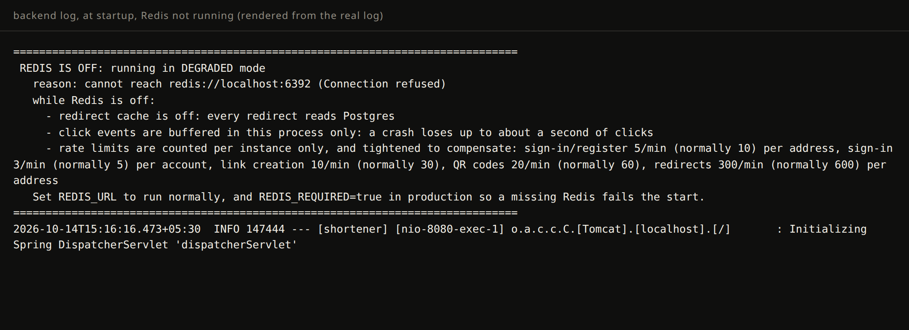
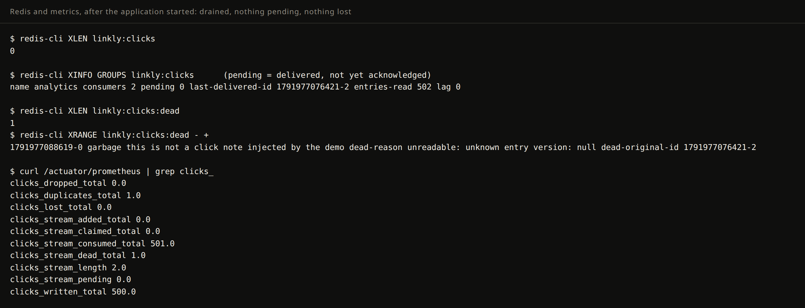
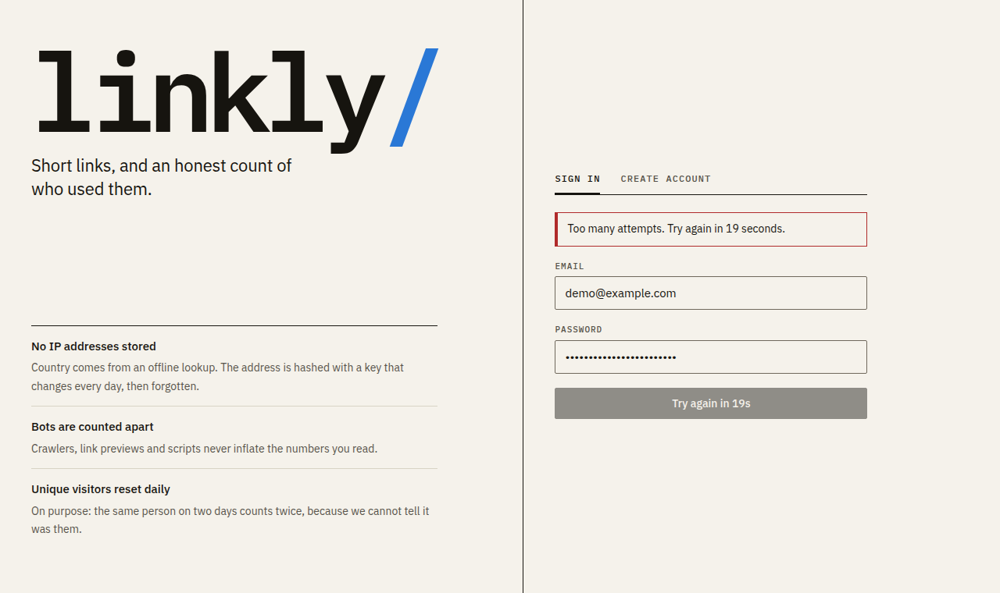

# Linkly: reference

Spring Boot 4 (Java 21) + PostgreSQL backend, React + TypeScript frontend.

Detailed reference: configuration, Redis modes, rate limiting, click pipeline, auth, API. The overview and the headline numbers are in the [README](../README.md).

## Run it locally (no Docker needed)

You need Java 21 and Node 18.18 or newer.

```bash
# 1. backend on http://localhost:8080 (real Postgres inside the JVM, data kept in backend/.dev-data/)
cd backend
./mvnw spring-boot:run -Dspring-boot.run.profiles=embedded,local

# 2. frontend on http://localhost:5173 (proxies /api to the backend), in a second terminal
cd frontend
npm install
npm run dev
```

Open http://localhost:5173, create an account, shorten a link. The backend alone also serves its API docs (Swagger UI)
at http://localhost:8080. To see a populated dashboard, make a few links and run `node scripts/demo-seed.mjs`
(see the header of that file).

```bash
./mvnw verify      # backend: unit + integration tests (integration tests start a throwaway Postgres)
npm test           # frontend: 94 tests
REDIS_SERVER_BIN=$(scripts/dev-redis.sh path) ./mvnw verify   # backend incl. the Redis tests (skipped if no redis-server)
npm run build      # frontend: typecheck + production build
```

Redis is optional: without it the app still starts and works, in a reduced mode that it announces loudly (see
[Redis](#redis)). To run normally, start one with `scripts/dev-redis.sh start`.

The `embedded` profile is for local development and tests only: it carries a throwaway JWT secret, non-Secure cookies
and a fast password hash. Never use it anywhere real.

## Frontend

React 19, TypeScript, Vite, TanStack Query, React Router. No UI kit and no chart library: the interface and the charts
are hand-built (about 15 KB of CSS, ~100 KB of JavaScript gzipped).

- **One origin.** The app and the API share an origin (the Vite proxy in development, a reverse proxy in production),
  so the auth cookies are first-party and the API needs no CORS.
- **Auth plumbing lives in one place** (`src/api/client.ts`): it adds the CSRF header to every write, renews an expired
  session once (shared between concurrent requests) and retries, and turns problem+json errors into per-field messages.
- **Charts follow a written spec**: one colour for a single series, hairline grid, 2px line, bars capped at 12px with a
  rounded data end, a table view behind every chart, keyboard and screen-reader access to every value, previous data kept
  on screen (dimmed) while a new period loads.
- **Design**: warm paper and near-black ink, IBM Plex Sans and Mono, rules instead of cards, one data colour. Light and
  dark are both designed (the data colour was checked against both surfaces), with a manual toggle.
- Set `VITE_GOOGLE_CLIENT_ID` (see `frontend/.env.example`) to show "Continue with Google" on the sign-in page.

## Configuration (environment variables)

| Variable | Required | Meaning |
|---|---|---|
| `DB_URL`, `DB_USER`, `DB_PASSWORD` | yes | PostgreSQL connection |
| `JWT_SECRET` | yes | HMAC key for access tokens, >= 32 bytes. The app refuses to start without it. |
| `APP_BASE_URL` | yes | Public origin used to build short URLs, e.g. `https://sho.rt` |
| `CODE_ALPHABET` | no locally, **yes in production** | Shuffled base62 alphabet for generated codes. Never change it after launch. The `prod` profile (the Docker image) refuses to start without it. |
| `COOKIE_SECURE` | no (default `true`) | Only set `false` for plain-http localhost |
| `REDIS_URL` | recommended | `redis://[:password@]host:6379/0` (`rediss://` for TLS). Unset = Redis off, degraded mode. |
| `REDIS_REQUIRED` | production: `true` | Refuse to start unless Redis is reachable |
| `ANALYTICS_SALT` | yes | Secret mixed into the daily visitor hash, >= 16 bytes. The app refuses to start without it. |
| `GEOIP_DB` | no | Path to a `.mmdb` country database. Blank = no country data. A set but missing path fails startup. |
| `SPA_ENABLED` | no (default `false`) | Serve the React app from the same process (the Docker image sets it). Needs the built app inside the jar. |
| `GOOGLE_CLIENT_ID` | for Google login (backend) | OAuth client id (Google Cloud Console). Blank = Google sign-in returns 503. |

## Links and short codes

- Destination URLs: http/https only, up to **8,192 characters** (measured after percent-encoding, so a long
  non-ASCII URL counts for more than it looks).
- Generated codes look like `linkly-KZrNBm`: a fixed `linkly-` prefix plus a Sqids encoding of a database sequence
  value. The prefix is configurable (`app.code.prefix`) and reserved: custom aliases may not start with it, so the
  prefix always means "generated by us" and a generated code can never clash with an alias.
- Custom aliases: 3-32 characters (letters, digits, `-`, `_`), minus reserved words like `admin` and `login`.
- Because the redirect puts the destination in the `Location` header, Tomcat's response-header limit is raised to
  16 KB (`server.tomcat.max-http-response-header-size`). **Any proxy in front must allow it too**, e.g. for nginx set
  `proxy_buffer_size 16k;` and `large_client_header_buffers 4 16k;`. Otherwise long links return 502 in production.

## Redis

Redis speeds redirects up (a cache in front of Postgres), backs the rate limits, and makes the click queue durable. **The app does not need it to run**: it has three modes and always says which one it is in.

| Mode | When | What happens |
|---|---|---|
| NORMAL | `REDIS_URL` set and reachable | cache on |
| DEGRADED (off) | `REDIS_URL` not set | everything works, straight from Postgres |
| DEGRADED (down) | set, but unreachable (at start or later) | same, and it recovers by itself when Redis returns |

How it says so: a banner in the log at startup, a `WARN` when Redis is lost and an `INFO` when it returns,
`/actuator/health` (`"redis": "DEGRADED"`, still HTTP 200 so load balancers keep sending traffic), and the `redis.up` and
`redis.fallbacks` metrics. In production set `REDIS_REQUIRED=true`: the app then refuses to start without Redis instead of
silently running degraded.

```bash
scripts/dev-redis.sh start    # installs redis-server with micromamba (no Docker, no root), runs it on :6379
scripts/dev-redis.sh status | stop | cli | path
```

**Redirect cache.** `GET /{code}` looks in Redis first, then Postgres, and stores the answer (15 minutes, jittered ±10%,
and never longer than the link's own expiry). "No such code" and "gone" are remembered for 30 seconds, so probing random
codes does not hammer Postgres. Deactivating a link evicts it after the transaction commits, and again a second later; a
creation evicts a remembered "no such code". If Redis cannot be reached when an eviction is needed, it is queued and retried
when Redis returns, so a deactivated link is never served from a stale entry once Redis is reachable again. A burst of
requests for one cold code causes one database read, not hundreds. Redis calls time out after 100 ms and a failing Redis is
skipped immediately, so a slow or dead Redis can never slow a redirect down. Metrics: `cache.link{result=hit|miss|negative|unavailable}`.





Tests use a real `redis-server` (found via `REDIS_SERVER_BIN`, `PATH`, or the script's install folder) and exercise killing
it mid-test, freezing it to simulate a network partition, and a deliberately slow command. Without a redis-server those
tests skip; set `LINKLY_REQUIRE_REDIS=true` (as CI should) to make that a failure instead.

## Rate limiting

Token buckets (Bucket4j): limits are per time window and refill smoothly. Over the limit you get **429** with a
`Retry-After` header and a problem+json body (`retryAfterSeconds`); the web app turns that into a countdown on the button.

| What | Counted per | Normal | While Redis is off |
|---|---|---|---|
| Sign-in, register, Google sign-in (together) | client address | 10 / min | 5 / min |
| Sign-in attempts | account (whichever address they come from) | 5 / min | 3 / min |
| Creating links | signed-in user | 30 / min | 10 / min |
| QR codes | signed-in user | 60 / min | 20 / min |
| Following short links | client address, **per instance only** | 600 / min | 300 / min |

All numbers live under `app.rate-limit.policies`. Why the tighter column: with Redis off every instance counts alone, so
the same protection needs a smaller number per instance. The startup banner lists exactly these numbers.

- **Shared counting.** With Redis the buckets are shared by all instances. A Redis failure moves a check onto the local,
  stricter path at once, so a limit check can never turn into a 500.
- **Redirects are counted per instance only** (`local-only: true`), so the hottest path never pays an extra Redis round trip.
- **Requests refused earlier don't count.** Limits run after security, so a request that fails CSRF or authentication
  never uses up anyone's allowance.
- **Privacy.** Addresses, emails and user ids are HMAC-hashed before they become a key, so Redis never holds a raw one.
  IPv6 clients are counted by /64 (one subscriber owns the whole block; counting single addresses would make the limit
  trivial to dodge).
- **The client address must be trustworthy.** Behind a proxy, `X-Forwarded-For` is honoured only from private/loopback
  addresses (Tomcat's own handling), not from anyone, so a client cannot choose its own address. If your proxy has a public
  address, list it: `SERVER_TOMCAT_REMOTEIP_INTERNAL_PROXIES=203\.0\.113\.\d+`.
- Metrics: `ratelimit.requests{policy, result=allowed|denied, store=redis|local}`.



## QR codes

Every link has a QR code, on its page in the app with PNG and SVG downloads, and from the API at
`GET /api/links/{id}/qr`. It is drawn on the server with ZXing and encodes the exact short URL, so it can never
disagree with the link. Error correction is level Q (survives about a quarter of the code being damaged) and the quiet
zone is the 4 modules the QR specification asks for. PNG modules are whole pixels, so the size you ask for is a target:
you get the largest whole multiple of the module count that fits. The tests decode what the code draws back with a real
QR reader, for both formats.

## Click analytics

How a click becomes a chart:

1. `GET /{code}` resolves the link and returns the 302. On the way it captures the click: the country (an offline lookup)
   and the visitor hash are worked out right there, and the IP address is dropped on the spot. The click is then handed off
   **without waiting**, and nothing else runs on the redirect, so analytics can never slow it down or break it.
2. **Redis up: through a Redis Stream.** The click is sent with a non-blocking `XADD`. It is durable (it survives the app
   crashing or restarting) and shared: every instance of the app runs a consumer in one consumer group, so each click goes to
   exactly one of them.
   **Redis off or down, or the send fails: through an in-process queue.** A bounded in-memory queue, drained every second.
   The click is never lost to a Redis problem, but a hard crash can lose up to about a second of the clicks held there.
3. A consumer reads a batch, parses the User-Agent, and stores it in Postgres **in one SQL statement**: it inserts the
   events that are new and adds to `link_daily_stats` using only the rows that were actually inserted. Only after the commit
   does it acknowledge the click and delete it from the stream.
4. Dashboards read `link_daily_stats` (small, pre-aggregated) for totals and the daily series, and the raw events for
   unique visitors and breakdowns (country, device, browser, OS, referrer).

**Exactly once.** Every click gets an id (a UUID) at the redirect, and the database ignores an id it already has. So the
same click arriving twice changes nothing: a consumer crashing between "stored" and "acknowledged" (the click is then
delivered again), a click that reached both the stream and the in-process queue (a send that timed out but was applied), or
two instances handling it at the same moment. Both the events and the daily totals stay right, and
`clicks.duplicates` counts the repeats that were recognised.

**Failure handling in the stream.** A batch that fails to store stays pending and is retried. An entry delivered to an
instance that then died is taken over by another after `claim-idle` (30 s, `XAUTOCLAIM`). An entry that cannot be read, or
that fails `max-attempts` times, moves to the dead-letter stream `{prefix}clicks:dead` (with the reason) instead of blocking
the rest. If Redis loses the stream or the group (a restart without persistence), the consumer recreates it. The stream is
capped (`max-length`) so a stalled consumer cannot eat Redis memory.

What is and isn't counted: only successful `GET` redirects (not `HEAD`, 404 or 410). Crawlers, link previews and scripts
are detected and counted separately as `botClicks`; they are kept out of every human number.

Privacy: the raw IP is never stored, in memory beyond the redirect or in Redis. It is used on the redirect for the country
lookup and to compute a visitor hash, `HMAC(daily key, ip + user agent)`, and then dropped, so it can never reach a durable
stream. The key changes every UTC day, so a visitor cannot be tracked across days, which also means **unique visitors are
counted per day** (the same person on two days counts twice). Only the host of the Referer is kept, never its path or query.
The User-Agent text does travel through the stream (it is parsed later, off the redirect path) and is deleted from the stream
once the click is stored; only its parsed parts (browser, OS, device) are kept. Raw events are kept for
`app.analytics.retention-days` (default 365): whole monthly partitions are dropped, while the daily rollups are kept.

Known limits: with Redis up, a click is acknowledged by the redirect before Redis confirms the `XADD` (that is what keeps
the redirect from waiting), so a hard crash in the few milliseconds between the two can lose that click; a graceful
shutdown waits for sends in flight. With Redis off, clicks are held in memory and a hard crash loses up to about a second.
Client IPs are taken from `X-Forwarded-For` only when it comes from a trusted proxy (see Rate limiting), so a caller cannot
fake their country or inflate unique visitors.

**Country data.** Download a free MaxMind-format country database and point `GEOIP_DB` at it. DB-IP Lite needs no signup:

```bash
mkdir -p backend/.dev-data/geoip && cd backend/.dev-data/geoip
curl -O https://download.db-ip.com/free/dbip-country-lite-$(date +%Y-%m).mmdb.gz && gunzip dbip-country-lite-*.mmdb.gz
```

DB-IP Lite is licensed CC BY 4.0: the UI must show "IP Geolocation by DB-IP" with a link to https://db-ip.com. The
`local` profile expects it at `.dev-data/geoip/dbip.mmdb`. Without a database, clicks are stored with country "Unknown".

Metrics (at `/actuator/prometheus`): `clicks.recorded` (accepted anywhere), `clicks.written` (stored, by either path), `clicks.duplicates`
(recognised repeats), `clicks.dropped` and `clicks.lost` (the only ways a click is lost), `clicks.queue.size` (in-process
queue), and for the stream `clicks.stream.added`, `.add.failed`, `.consumed`, `.claimed` (taken over from a dead consumer),
`.dead` (dead-lettered), and the gauges `clicks.stream.length` and `clicks.stream.pending`. Tunables are under
`app.analytics.stream` (batch size, claim time, attempts, cap, and an `enabled` switch).

## Performance

Measured with [k6](https://k6.io) (`load-test/`), one app instance (`-Xms1g -Xmx1g`), embedded Postgres 17, Redis 7, **all on one 4-core 2014 desktop CPU (i5-4460S) that also runs the load generator**. Real hardware would do better; these numbers are a floor, and what they show is the shape. Reproduce: `load-test/run.sh <redis-on|redis-off|cache-only|redis-on-limits> [redirect|create]`.

**Redirects** (1,000 links, skewed traffic, a new client address and a random browser on every request, 20 s per step):

| target req/s | Redis on: achieved, p95 | Redis off: achieved, p95 |
|---:|---:|---:|
| 1,000 | 1,000 req/s, 2.6 ms | 996 req/s, 9.4 ms |
| 3,000 | 2,999 req/s, 7.8 ms | 2,980 req/s, 15.3 ms |
| 4,000 | 3,994 req/s, 13.9 ms | 3,976 req/s, 19.5 ms |
| 5,000 | 4,868 req/s, 39 ms | 4,757 req/s, 75 ms |

- No failed requests in any run. In every run the number of stored clicks matched the number of redirects answered exactly (about 300,000 per run), with nothing dropped or lost.
- With Redis the redirect cache hits 99.7% of the time and Postgres is nearly idle (0.04 CPU-s per 1,000 redirects). Without it every redirect reads Postgres (0.17 CPU-s per 1,000), which costs latency at the top end but still works.
- Link creation (a database write per request): 300 req/s with p95 5 ms.
- Not a capacity claim: past about 4,000 req/s on this box the generator, app and database fight over four cores. Under that saturation Redis commands occasionally exceed their 100 ms timeout; 5 in a row switch the app to degraded mode for a moment. One run with rate limiting on hit that at the 5,000 step (6 brief flips): nothing was lost, duplicates were recognised, but that step dropped to 3,400 req/s with p95 377 ms. Treat 4,000 as the ceiling on this hardware.

**What the load test found and fixed**
1. The click consumer stored only 669 clicks/s: parsing the User-Agent took 99% of its time. A size-capped memo cache of parse results brought it to about 20,000 clicks/s per consumer thread, and CPU per 1,000 redirects fell from 1.15 s to 0.64 s.
2. A single Redis reply slower than 100 ms switched the whole app to degraded mode. Timeouts now need 5 in a row; a lost connection still trips at once.

## Auth model

- Email + password (BCrypt) and Google sign-in. The browser gets a Google ID token and posts it to `/api/auth/google`;
  the backend verifies it against Google's keys (signature, expiry, issuer, audience, verified email).
- Session = 15-minute JWT access token + 14-day rotating refresh token, both in HttpOnly cookies.
  Refresh tokens are stored hashed; reusing a spent one revokes the whole login.
- CSRF: `GET /api/auth/csrf` sets an `XSRF-TOKEN` cookie; send its value back in the `X-XSRF-TOKEN` header on every
  POST/DELETE. Serve the SPA and API from one origin (Vite dev proxy / nginx) so no CORS is needed.
- Signing in with Google using an email that already has a password account links the two and removes the password
  (emails are not verified at signup, so the Google proof of ownership wins).

## API

| Endpoint | Purpose |
|---|---|
| `GET /{code}` | public 302 redirect (404 unknown, 410 expired or deactivated) |
| `GET /api/auth/csrf` | bootstrap the CSRF cookie |
| `POST /api/auth/register`, `/login`, `/google`, `/refresh`, `/logout`; `GET /api/auth/me` | accounts and sessions |
| `POST /api/links`, `GET /api/links?page&size`, `GET /api/links/{id}`, `DELETE /api/links/{id}` | manage your links (responses include `totalClicks`) |
| `GET /api/links/{id}/qr?format=png\|svg&size=512` | QR code of the short URL (PNG, or SVG for print); `size` 64-2048 |
| `GET /api/links/{id}/stats?days=30` | one link: totals, daily series, countries, devices, browsers, OS, referrers (`days` 1-90) |
| `GET /api/stats/overview?days=30` | all your links: totals, daily series, top 5 links |
